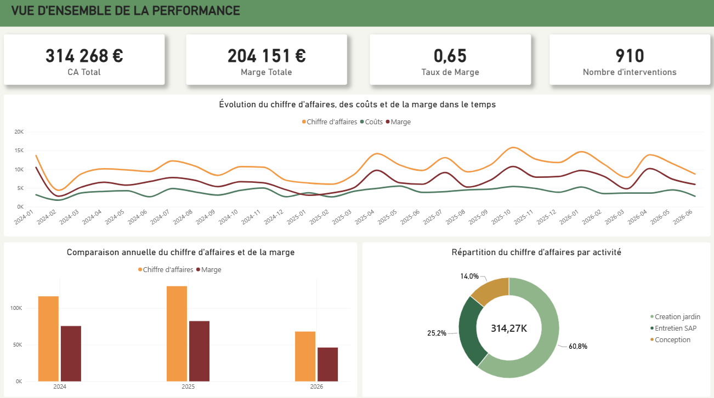
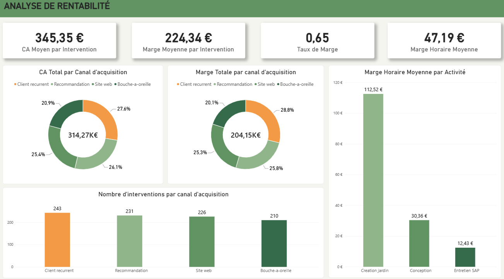
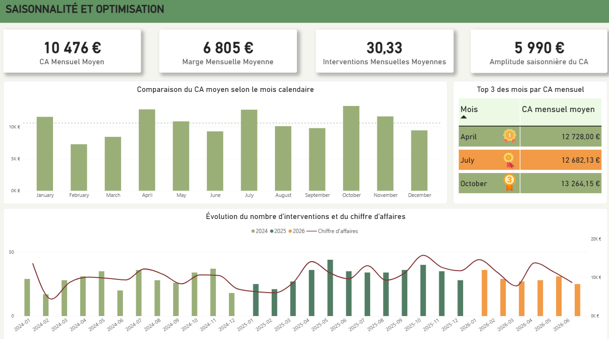

# 🌿 Analyse de performance et optimisation de la rentabilité – Entreprise de paysagisme

## Présentation

Ce projet consiste à analyser la performance économique et opérationnelle d'une entreprise de jardinage située en Île-de-France.

Réalisé dans le cadre d'une mission freelance, il s'appuie sur environ 900 interventions réparties sur 3 ans.

L'objectif est d'identifier les leviers de rentabilité, d'analyser les performances commerciales et opérationnelles et de formuler des recommandations concrètes d'optimisation.

## Objectif métier

L'analyse vise à comprendre les facteurs qui influencent la rentabilité de l'entreprise :

Évolution du chiffre d'affaires, des coûts et des marges.
Rentabilité des prestations et marge horaire.
Performance des clients et canaux d'acquisition.
Analyse géographique et saisonnalité.
Identification des opportunités d'amélioration économique.
Sources de données
Source	Description
Données métier	Historique des interventions
Volume	Environ 900 observations
Période	3 années d'activité
Variables	Prestations, clients, CA, coûts, heures travaillées et marges
Pipeline d'analyse

1. Analyse exploratoire

Statistiques descriptives, distributions et valeurs atypiques.
Nettoyage et contrôle de la qualité des données.

2. Performance et rentabilité

Analyse du CA, des coûts et des marges.
Comparaison par prestation, client et canal d'acquisition.
Étude de la rentabilité horaire.

3. Analyse statistique et optimisation

Tests d'hypothèses et intervalles de confiance.
Analyse de la robustesse et simulations économiques.

4. Visualisation et recommandations

Synthèse des résultats.
Identification des leviers d'optimisation.
Recommandations opérationnelles.
Technologies utilisées
Python : Pandas, NumPy, SciPy, Statsmodels, Matplotlib, Seaborn.
Power BI : DAX, KPI, modélisation en schéma en étoile et reporting interactif.
Compétences mises en œuvre
Analyse exploratoire et statistique.
Analyse de rentabilité et performance économique.
Inférence statistique.
Analyse de saisonnalité.
Modélisation décisionnelle.
Business Intelligence et Data Visualization.
Aide à la décision.
Structure du tableau de bord Power BI

Rapport interactif organisé en quatre pages :

Vue d'ensemble : KPI financiers, CA, coûts et marges.
Rentabilité : prestations, clients, communes et canaux d'acquisition.
Saisonnalité : tendances mensuelles et périodes de performance.
Recommandations : synthèse des résultats et axes d'optimisation.
Livrable final

Une étude quantitative combinant analyse descriptive, inférence statistique et optimisation économique, accompagnée d'un tableau de bord décisionnel et de recommandations concrètes visant à améliorer durablement la rentabilité de l'entreprise.

# Aperçu du tableau de bord

### 1. Vue d'ensemble

### 2. Analyses de performances

### 3. Saisonnalités et optimisation

